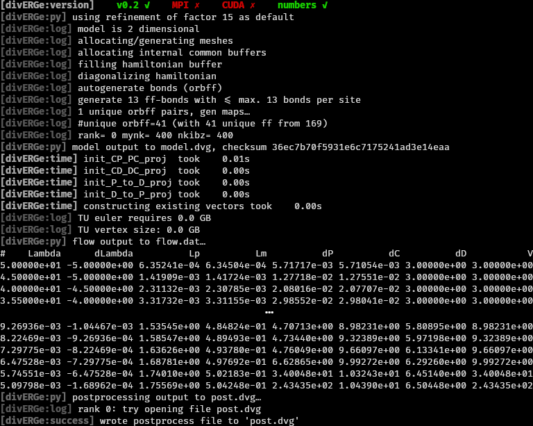

.. divERGe documentation master file, created by
   sphinx-quickstart on Fri Apr  5 13:32:25 2024.
   You can adapt this file completely to your liking, but it should at least
   contain the root `toctree` directive.

TODO: INCLUDE VERSION AS VARIABLE IN HERE. SPHINX SHOULD DEFINITELY BE ABLE TO
DO THIS!!!

divERGe implements various Exact Renormalization Group examples
===============================================================

.. toctree::
   :maxdepth: 3
   :caption: Contents:

   Getting Started <self>
   Compilation
   C Interface

.. toctree::
   :maxdepth: 2

   Examples
   Python Interface
   Simulation Output
   Runtime Tuning

Getting Started
---------------
For an easy start with the :ref:`Python Interface`, install divERGe from pip via

.. sourcecode:: bash

    pip install diverge-flow

You can further download `divERGe.tar.gz
<https://git.rwth-aachen.de/frg/diverge/-/raw/master/public/releases/v0.6/divERGe.tar.gz>`_
to obtain a pre-compiled copy of divERGe that additionally contains the :ref:`C
Interface` and some :ref:`Examples`. For more pre-built versions, see `releases
<https://git.rwth-aachen.de/frg/diverge/-/tree/master/public/releases>`_. If you
wish to :ref:`compile yourself <Compilation>` to include various optimizations
(MPI, CUDA, ...), you can do so by cloning the `git repository
<https://git.rwth-aachen.de/frg/diverge.git>`_ and following the :ref:`build
instructions <Compilation>`. Moreover, environment variables can be used to
change the number of threads for different components, see :ref:`Runtime
Tuning`.

Usage
-----
The :ref:`C Interface` represents the centrum of divERGe. Python specific
library features (e.g. the :ref:`AutoflowSec` function) are documented
:ref:`here <Python Interface>`. For reading the output files, see the
documentation for :ref:`diverge.output <Simulation Output>` *and also the Python
doc obtained from within Python using help(object), i.e.,*

.. sourcecode:: Python

    import diverge.output as do
    help(do.diverge_model)
    help(do.diverge_post_tu)

In general, the naming for Python functions follows the C function naming,
except for that the ``diverge_`` prefix is omitted.

We now continue with the example: On a not-too-old Linux machine (GLIBC >=
2.17), extract the tar.gz file and use a python3 interpreter to execute `the
simple example
<https://git.rwth-aachen.de/frg/diverge/-/blob/master/examples/python/simple.py>`_.
Alternatively, download the simple example directly from the repo `here
<https://git.rwth-aachen.de/frg/diverge/-/blob/master/examples/python/simple.py>`_.

.. sourcecode:: bash

    mkdir divERGe
    tar -C divERGe -xvf divERGe.tar.gz
    cd divERGe

You should now see output as below:

Troubleshooting
---------------

If the pip installation fails, you can navigate to the folder where you
extracted `diverge.tar.gz
<https://git.rwth-aachen.de/frg/diverge/-/raw/master/public/releases/v0.6/divERGe.tar.gz>`_
and execute

.. sourcecode:: bash

    python3 setup.py install

Congratulations
---------------

You've just managed to do your first FRG simulation of a square lattice Hubbard
model that displays :math:`d`-wave superconductivity! Now let's take a look at
the output:

Besides the compilation status of the library (first line) and some logging
information (prefixed with ``[divERGe:logname]``), the on-line output contains
information on chosen defaults and other miscellaneous information (prefixed
with #): We observe that two files have been written: model.dvg (containing
everything set in the :ref:`Model`) and post.dvg (see :ref:`Postprocessing and
Output`). To read the .dvg files, we strongly suggest to use the function
provided in the python library (see :ref:`Simulation Output`). Apart from the
output files, the values for the scale and integration of the flow equations as
table with entries Lambda, dLambda, Lp, Lm, dP, dC, dD, V are printed This
output can be conveniently piped to a file to obtain a flow data file for
further processing. Instead of

.. sourcecode:: bash

    python3 examples/simple.py

you can call

.. sourcecode:: bash

    python3 examples/simple.py > flow.dat

to obtain three files as output: model.dvg, post.dvg, and flow.dat (with the
flow information). The columns in flow.dat correspond to:

Lambda
    the current scale
dLambda
    the step size
Lp
    the particle particle loop maximum
Lm
    the particle hole loop maximum
dP
    the differential (for grid and patch) or absolute (for tu) channel maximum
    in the particle particle channel
dC
    the differential (for grid and patch) or absolute (for tu) channel maximum
    in the crossed particle hole channel
dD
    the differential (for grid and patch) or absolute (for tu) channel maximum
    in the direct particle hole channel
V
    the absolute maximum element of the vertex (for grid/patch) or maximum of
    the channel maxima (tu)

License
-------

divERGe is published under the `GPLv3
<https://www.gnu.org/licenses/gpl-3.0.html>`_. The license is found in the `git
repo <https://git.rwth-aachen.de/frg/diverge/-/tree/master/LICENSE.md>`_.
License information from within divERGe can be obtained by calling
:c:func:`diverge_license` or :c:func:`diverge_license_print`.

Indices and tables
------------------

* :ref:`genindex`
* :ref:`search`

